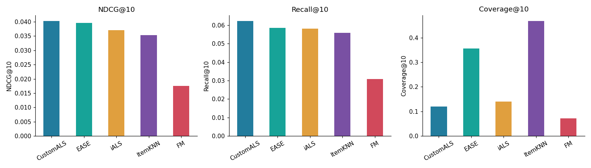

# Персональные top-10 рекомендации: пять моделей с нуля

**Студент: Мелеховец Кирилл Сергеевич.**
Домашнее задание 1 по рекомендательным системам.

Датасет: **Amazon Reviews 2014, Video Games, 5-core** — [первоисточник, Julian McAuley / UCSD](https://cseweb.ucsd.edu/~jmcauley/datasets/amazon/links.html).
231 780 взаимодействий, 24 303 пользователя, 10 672 товара после очистки.
Отзывы содержат оценки 1–5 и timestamp; отдельно загружаются названия и категории товаров.
Проверены [семинары курса, ветка 26f](https://github.com/girafe-ai/recsys/tree/26f/seminars): этот датасет там не используется.

Основная работа — [experiments.ipynb](experiments.ipynb): выполненные ячейки, EDA, формулы,
протокол, подбор на validation, итоговые таблицы и графики, абляции и ограничения.

## Модели

| Модель | Реализация | Особенность |
|---|---|---|
| ItemKNN | [models/item_knn.py](models/item_knn.py) | cosine, shrinkage по числу общих пользователей, top-k соседей |
| iALS | [models/ials.py](models/ials.py) | binary preference rating ≥ 4, собственные чередующиеся решения систем |
| EASE | [models/ease.py](models/ease.py) | constrained ridge, аналитическое решение с нулевой диагональю |
| FM | [models/fm.py](models/fm.py) | взаимодействия второго порядка, BCE, причинные метапризнаки пользователей/товаров |
| Custom-target ALS | [models/custom_als.py](models/custom_als.py) | новый preference target: оценка, строгость пользователя и давность; confidence совпадает с iALS |

Обучение, скоринг и top-10 реализованы самостоятельно. PyTorch используется для тензоров,
FM и autograd; готовых рекомендательных моделей нет.
Метапризнаки FM — предшествующая активность, сглаженная средняя оценка, давность активности
пользователя и возраст товара. Они вычисляются строго до timestamp примера, без текущего
отзыва и событий того же дня. Неверсионированные snapshot-признаки каталога не используются
при обучении: их доступность в исторический момент нельзя подтвердить.

## Протокол

- Train: до 2013-01-01 UTC; validation: 2013 год; test: 2014-01-01 — 2014-07-22.
- До подбора выбрана основная метрика **NDCG@10**. Дополнительные: Recall@10, Precision@10 и Coverage@10.
- Все методы внутри этапа используют одинаковую warm-start когорту и полный исторический каталог кандидатов.
- Из top-10 исключаются все ранее оценённые товары, включая низкие оценки. Релевантность — будущий rating ≥ 4.
- Когорта: ≥3 положительных отзыва в истории, ≥1 будущего релевантного warm item и ≥10 кандидатов.
- 19 заранее заданных validation-конфигураций, затем фиксация параметров и переобучение на train+validation.
- Два контроля: FM только с ID и custom ALS при параметрах выбранного базового iALS.
- Парный bootstrap различий пользовательских метрик: 2000 перевыборок, seed=42.

Разбиения глобальные по времени; профиль не обновляется внутри оценочного окна.
Cold-start события учитываются в аудите и исключаются из основной оценки.
Ограничения 5-core, exposure bias, горизонта оценки и размера поиска разобраны в ноутбуке.

## Полученные результаты

Test: **3 532 пользователя**, каталог **10 460 товаров**; полный перебор кандидатов.

| Модель | NDCG@10 | Recall@10 | Coverage@10 |
|---|---:|---:|---:|
| CustomALS | 0.04028 | 0.06232 | 11.94% |
| EASE | 0.03958 | 0.05847 | 35.55% |
| iALS | 0.03705 | 0.05822 | 13.96% |
| ItemKNN | 0.03528 | 0.05587 | 46.82% |
| FM | 0.01751 | 0.03092 | 7.22% |



FM с метапризнаками: NDCG@10 **0,01751** против **0,01372** у ID-only;
95% CI парной разности [0,00018; 0,00740].
Custom ALS после отдельного подбора: прирост NDCG относительно iALS **+0,00323**,
95% CI [0,00042; 0,00586]. При **одинаковых параметрах ALS** прирост составляет +0,00235,
но CI [−0,00048; 0,00510] включает ноль. Весь выигрыш нельзя приписать только новому таргету.
Небольшая разница с EASE также не означает доказанного статистического превосходства.

[Все validation trials](results/validation_trials.csv) · [Финальные параметры и метрики](results/test_results.csv) ·
[Парные сравнения](results/paired_comparisons.csv) · [Выводы](results/conclusions.md).

## Воспроизведение

Python **3.11**, CPU, желательно 12 ГБ свободной оперативной памяти из-за плотных матриц EASE.

```bash
git clone https://github.com/kizotozxc/recsys-top10-amazon-video-games.git
cd recsys-top10-amazon-video-games
python3.11 -m venv .venv
source .venv/bin/activate
python -m pip install -r requirements.txt
python run_notebook.py
python -m pytest -q
```

`run_notebook.py` сам создаёт локальное Jupyter-ядро для текущего Python, выполняет
все ячейки и сохраняет outputs в `experiments.ipynb`. Отдельный Jupyter server не нужен.
Для открытия в редакторе выберите Python из `.venv`.
На Linux для CPU можно сначала установить `torch==2.7.1` из официального индекса
`https://download.pytorch.org/whl/cpu`, как в CI, чтобы не загружать CUDA-библиотеки.
Случайные зерна: **42**, вычисления на CPU, 4 потока. [requirements-lock.txt](requirements-lock.txt)
фиксирует полное окружение выполненного эксперимента; переносимый набор прямых зависимостей —
[requirements.txt](requirements.txt). Между BLAS/ОС возможны малые численные различия и другие времена выполнения.

При первом запуске автоматически загружаются около 137 MB из исходного Stanford/UCSD архива:

- [reviews_Video_Games_5.json.gz](https://snap.stanford.edu/data/amazon/productGraph/categoryFiles/reviews_Video_Games_5.json.gz)
- [meta_Video_Games.json.gz](https://snap.stanford.edu/data/amazon/productGraph/categoryFiles/meta_Video_Games.json.gz)

Кеш по умолчанию: `.cache/amazon2014/`. Можно задать `RECSYS_DATA_DIR` с уже скачанными файлами.
Для каждого файла проверяется SHA-256; контрольные суммы находятся в [recsys/data.py](recsys/data.py).
Парсер метаданных использует `ast.literal_eval`, не `eval`.
Данные, обученные веса, матрицы, окружения и кеши исключены через `.gitignore` и не загружаются в GitHub.
Использование данных — исследовательское; права на исходные данные не передаются этим репозиторием.

## Структура

```text
experiments.ipynb       # основной выполненный ноутбук
models/                # пять отдельных реализаций
recsys/                # загрузка, причинные признаки, единая оценка, эксперименты
tests/test_methods.py  # проверки формул и протокола
results/               # агрегированные таблицы, графики, параметры и аудит
run_notebook.py        # воспроизводимое выполнение Run All
requirements.txt
requirements-lock.txt
.gitignore
```

Проверки охватывают нормальные уравнения ALS, убывание objective, ограничение EASE,
cosine/top-k соседей, формулу и точный ускоренный скоринг FM, временную причинность,
новый таргет, ручной расчёт метрик, cold/seen фильтрацию и ties.
